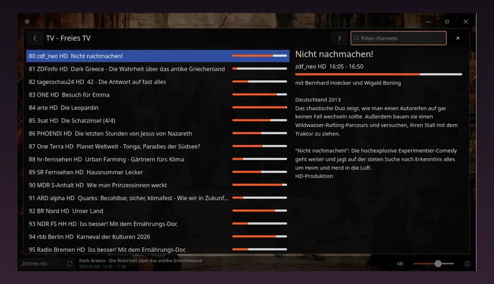

# Enigma2 Player

A lightweight GTK4/libmpv desktop player for Enigma2 receivers. It loads bouquets and EPG data, and puts bouquet switching, the channel list, and the current EPG into an on-player overlay.

<p align="center">
  
</p>

## Preview

<p align="center">
  
</p>

## Nightly downloads

Download Linux x86_64 builds from [GitHub Releases](https://github.com/Haehnchen/playground-enigma2-player/releases). Each successful build after a push to `master` publishes a `nightly-<commit>` prerelease with a `.tar.zst` asset. The last 10 nightly releases are kept.

Extract the downloaded `.tar.zst` archive and start the player:

```bash
tar --zstd -xf 'enigma2-player-linux-amd64-<commit>.tar.zst'
./enigma2-player
```

Extraction requires `zstd`. The binary requires GTK4, libmpv, and libepoxy at runtime; builds are produced on Ubuntu 24.04.

## Receiver

The receiver URL is stored in the user settings file:

```text
~/.config/enigma2-player/settings.json
```

The first start is intentionally empty. Open the Settings button in the top-left overlay and enter the Enigma2 receiver URL there.

For a one-off launch you can also pass a receiver URL on the command line:

```bash
cargo run -- --box-url http://enigma2.local
```

## Dependencies

On Ubuntu/Debian:

```bash
sudo apt install build-essential cargo rustc pkg-config libgtk-4-dev libmpv-dev libepoxy-dev mpv
```

Check the local machine:

```bash
./scripts/check-deps.sh
```

## Build

```bash
make build
```

This uses `cargo build --release` and strips the resulting binary.

Or build and copy the binary to `~/.local/bin`:

```bash
make install
```

`make install` only copies the binary to `~/.local/bin` and strips the installed copy.

## Run

```bash
make run
```

Or run the installed binary:

```bash
enigma2-player
```

Configure the receiver from Settings or pass `--box-url` for a temporary session.

## Test

```bash
make test
```

Manual smoke tests should cover receiver loading, bouquet switching, channel playback, EPG overlay scrolling, settings save/load, fullscreen, window dragging, resizing, mute, and volume scrolling.
